<div align="center">

<picture>
  <source media="(prefers-color-scheme: dark)" srcset="./assets/hero-dark.svg" />
  <source media="(prefers-color-scheme: light)" srcset="./assets/hero-light.svg" />
  
</picture>

<p align="center">
  <a href="https://github.com/yashlund05/aegis-cloud"><picture><source media="(prefers-color-scheme: dark)" srcset="./assets/planet-aegis-dark.svg" /><source media="(prefers-color-scheme: light)" srcset="./assets/planet-aegis-light.svg" />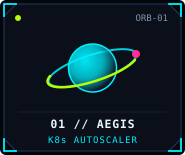</picture></a>
  <a href="https://github.com/yashlund05/os-subsystem"><picture><source media="(prefers-color-scheme: dark)" srcset="./assets/planet-neuroos-dark.svg" /><source media="(prefers-color-scheme: light)" srcset="./assets/planet-neuroos-light.svg" />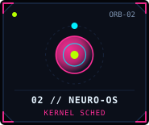</picture></a>
  <a href="https://github.com/yashlund05/digital-twins-ieee"><picture><source media="(prefers-color-scheme: dark)" srcset="./assets/planet-twin-dark.svg" /><source media="(prefers-color-scheme: light)" srcset="./assets/planet-twin-light.svg" />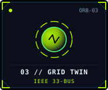</picture></a>
  <a href="https://github.com/yashlund05/Temporal-Knowledge-Graph"><picture><source media="(prefers-color-scheme: dark)" srcset="./assets/planet-tkg-dark.svg" /><source media="(prefers-color-scheme: light)" srcset="./assets/planet-tkg-light.svg" />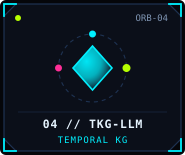</picture></a>
  <a href="https://github.com/yashlund05/enterprise-network-digital-twin-model"><picture><source media="(prefers-color-scheme: dark)" srcset="./assets/planet-nettwin-dark.svg" /><source media="(prefers-color-scheme: light)" srcset="./assets/planet-nettwin-light.svg" />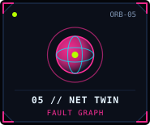</picture></a>
  <a href="https://github.com/yashlund05/MarineDebris-Sonar-AI"><picture><source media="(prefers-color-scheme: dark)" srcset="./assets/planet-sonar-dark.svg" /><source media="(prefers-color-scheme: light)" srcset="./assets/planet-sonar-light.svg" />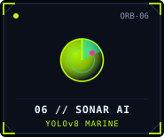</picture></a>
</p>

<sub>
  <strong>ORBITAL NAV:</strong>
  <a href="https://github.com/yashlund05/aegis-cloud">01 Aegis Cloud</a> &nbsp;·&nbsp;
  <a href="https://github.com/yashlund05/os-subsystem">02 NeuroOS-Lite</a> &nbsp;·&nbsp;
  <a href="https://github.com/yashlund05/digital-twins-ieee">03 Digital Twin Staleness</a> &nbsp;·&nbsp;
  <a href="https://github.com/yashlund05/Temporal-Knowledge-Graph">04 Temporal Knowledge Graph</a> &nbsp;·&nbsp;
  <a href="https://github.com/yashlund05/enterprise-network-digital-twin-model">05 Enterprise Network Twin</a> &nbsp;·&nbsp;
  <a href="https://github.com/yashlund05/MarineDebris-Sonar-AI">06 MarineDebris Sonar AI</a>
</sub>

</div>

---

## 01 // SYSTEM STATUS

<div align="center">

<picture>
  <source media="(prefers-color-scheme: dark)" srcset="./assets/system-status-dark.svg" />
  <source media="(prefers-color-scheme: light)" srcset="./assets/system-status-light.svg" />
  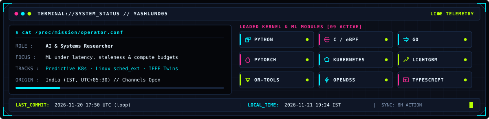
</picture>

</div>

---

## 02 // ACTIVE MISSIONS

<table width="100%">
  <tr>
    <td width="50%" valign="top">
      <a href="https://github.com/yashlund05/aegis-cloud"><picture><source media="(prefers-color-scheme: dark)" srcset="./assets/mission-aegis-dark.svg" /><source media="(prefers-color-scheme: light)" srcset="./assets/mission-aegis-light.svg" />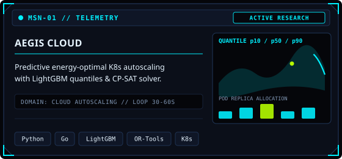</picture></a>

[**Aegis Cloud**](https://github.com/yashlund05/aegis-cloud) — Predictive, energy-optimal Kubernetes autoscaling with LightGBM quantile forecasts & CP-SAT optimization.
`ACTIVE RESEARCH` · `Python` · `Go` · `LightGBM` · `OR-Tools` · `K8s`

</td>
    <td width="50%" valign="top">
      <a href="https://github.com/yashlund05/os-subsystem"><picture><source media="(prefers-color-scheme: dark)" srcset="./assets/mission-neuroos-dark.svg" /><source media="(prefers-color-scheme: light)" srcset="./assets/mission-neuroos-light.svg" />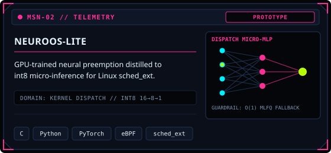</picture></a>

[**NeuroOS-Lite**](https://github.com/yashlund05/os-subsystem) — Asymmetric GPU-trained neural preemption distilled to int8 micro-inference for Linux `sched_ext`.
`PROTOTYPE` · `C` · `Python` · `PyTorch` · `eBPF` · `sched_ext`

</td>
  </tr>
  <tr>
    <td width="50%" valign="top">
      <a href="https://github.com/yashlund05/digital-twins-ieee"><picture><source media="(prefers-color-scheme: dark)" srcset="./assets/mission-twin-dark.svg" /><source media="(prefers-color-scheme: light)" srcset="./assets/mission-twin-light.svg" />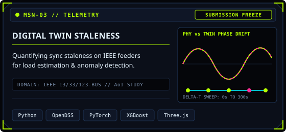</picture></a>

[**Digital Twin Staleness**](https://github.com/yashlund05/digital-twins-ieee) — Quantifying synchronization staleness on IEEE 13/33/123-bus feeders for load estimation & anomaly detection.
`SUBMISSION FREEZE` · `Python` · `OpenDSS` · `PyTorch` · `XGBoost` · `Three.js`

</td>
    <td width="50%" valign="top">
      <a href="https://github.com/yashlund05/Temporal-Knowledge-Graph"><picture><source media="(prefers-color-scheme: dark)" srcset="./assets/mission-tkg-dark.svg" /><source media="(prefers-color-scheme: light)" srcset="./assets/mission-tkg-light.svg" />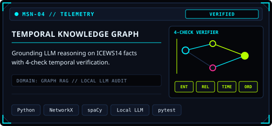</picture></a>

[**Temporal Knowledge Graph**](https://github.com/yashlund05/Temporal-Knowledge-Graph) — Grounding LLM reasoning on ICEWS14 timestamped facts with 4-check post-generation verification.
`VERIFIED` · `Python` · `NetworkX` · `spaCy` · `Local LLM` · `pytest`

</td>
  </tr>
  <tr>
    <td width="50%" valign="top">
      <a href="https://github.com/yashlund05/enterprise-network-digital-twin-model"><picture><source media="(prefers-color-scheme: dark)" srcset="./assets/mission-nettwin-dark.svg" /><source media="(prefers-color-scheme: light)" srcset="./assets/mission-nettwin-light.svg" />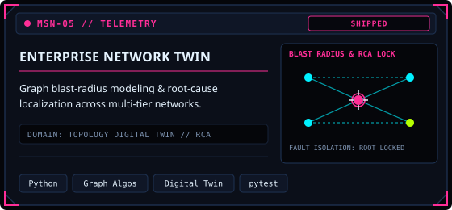</picture></a>

[**Enterprise Network Twin**](https://github.com/yashlund05/enterprise-network-digital-twin-model) — Graph-based blast-radius modeling and root-cause localization across multi-tier networks under alarm floods.
`SHIPPED` · `Python` · `Graph Algos` · `Digital Twin` · `pytest`

</td>
    <td width="50%" valign="top">
      <a href="https://github.com/yashlund05/MarineDebris-Sonar-AI"><picture><source media="(prefers-color-scheme: dark)" srcset="./assets/mission-sonar-dark.svg" /><source media="(prefers-color-scheme: light)" srcset="./assets/mission-sonar-light.svg" />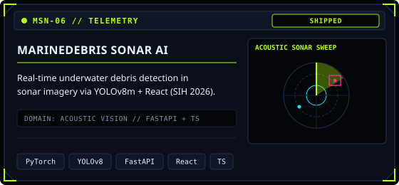</picture></a>

[**MarineDebris Sonar AI**](https://github.com/yashlund05/MarineDebris-Sonar-AI) — Real-time underwater debris detection in sonar imagery via YOLOv8m with a FastAPI & React studio (SIH 2026).
`SHIPPED` · `PyTorch` · `YOLOv8` · `FastAPI` · `React` · `TypeScript`

</td>
  </tr>
</table>

---

## 03 // CONTRIBUTION CITY

<div align="center">

<picture>
  <source media="(prefers-color-scheme: dark)" srcset="./assets/contrib-city-dark.svg" />
  <source media="(prefers-color-scheme: light)" srcset="./assets/contrib-city-light.svg" />
  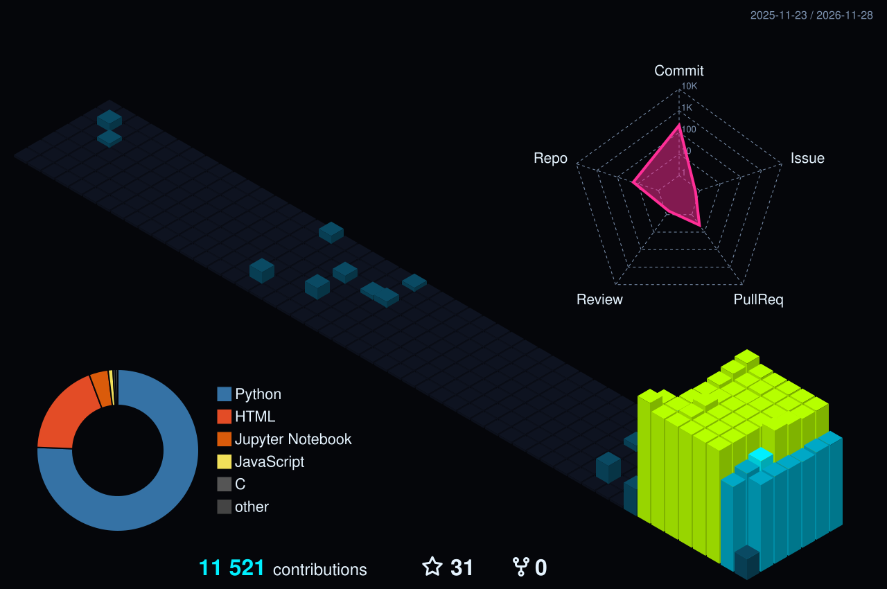
</picture>

<br/><br/>

<picture>
  <source media="(prefers-color-scheme: dark)" srcset="./assets/snake-dark.svg" />
  <source media="(prefers-color-scheme: light)" srcset="./assets/snake-light.svg" />
  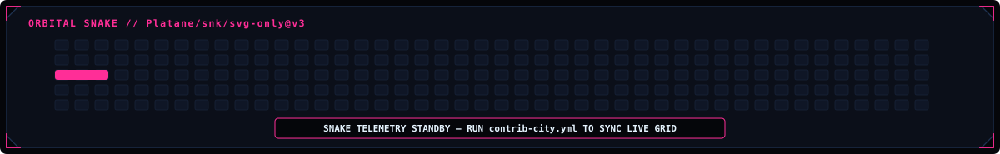
</picture>

</div>

---

## 04 // CLASSIFIED FILES

<details>
<summary><strong>[ CLASSIFIED // DOSSIER 01 ] SECONDARY MISSIONS ARCHIVE — CLICK TO DECLASSIFY</strong></summary>

<br/>

| Mission | Briefing | Stack | Coordinates |
| :--- | :--- | :--- | :--- |
| **Forecast Blend (SIH)** | Regime-aware weather forecast blending across 3 physical models and 2 AI models (MoES / NCMRWF). | `Python` `SQLite` `Streamlit` | [yashlund05/forecast-blend-SIH](https://github.com/yashlund05/forecast-blend-SIH) |
| **Voice Calculator** | Offline Windows running-total voice calculator using Vosk with a constrained number grammar. | `Python` `Vosk` | [yashlund05/business-voice-calculator](https://github.com/yashlund05/business-voice-calculator) |
| **Smart Job Scheduler** | Algorithmic comparison engine benchmarking Greedy, Dynamic Programming, and Branch & Bound backtracking. | `Python` `HTML/JS` | [yashlund05/Smart-Job-Scheduler](https://github.com/yashlund05/Smart-Job-Scheduler) |
| **Breast Cancer Incidence Forecasting** | Code and data for a JAIR paper on ML forecasting of breast cancer trends across Indian cancer registries. | `Python` `ML` | [yashlund05/breast-cancer-incidence-forecasting-india](https://github.com/yashlund05/breast-cancer-incidence-forecasting-india) |
| **KrishiDrishti (SIH)** | Smart India Hackathon agricultural ML prediction system behind a TypeScript front end. | `TypeScript` `ML` | [yashlund05/KrishiDrishti-SIH](https://github.com/yashlund05/KrishiDrishti-SIH) |
| **Project Ari** | Fintech market-intelligence build for IIT Techkriti with the Entropy Vanguard team. | `Python` `Jupyter` | [yashlund05/project_ari](https://github.com/yashlund05/project_ari) |
| **Automata Simulator** | Computational theory simulator supporting DFA, NFA, and PDA execution. | `Python` | [yashlund05/Automata-Simulator](https://github.com/yashlund05/Automata-Simulator) |

</details>

<br/>

<details>
<summary><strong>[ CLASSIFIED // DOSSIER 02 ] PILOT LOG — CLICK TO DECLASSIFY</strong></summary>

<br/>

> **CLEARANCE:** `OPEN` &nbsp;|&nbsp; **SECTOR:** `India (IST)` &nbsp;|&nbsp; **CALLSIGN:** `yashlund05`

I build at the seam where **machine learning meets systems constraints**: what breaks when a learned decision arrives too late, reads stale telemetry, or costs more cycles than the decision it replaces.

Across cloud autoscalers, Linux `sched_ext` dispatchers, IEEE distribution-feeder digital twins, and temporal knowledge graphs, I treat **honest measurement** as the primary instrument — publishing failure modes, non-supported hypotheses, and simulation boundaries alongside positive gains.

</details>

<br/>

<details>
<summary><strong>[ CLASSIFIED // DOSSIER 03 ] DEEP SPACE INTERCEPT — CLICK TO DECLASSIFY</strong></summary>

<br/>

> **INTERCEPT LOCK:** `1420.405 MHz` — Encrypted carrier burst detected behind Mission Control bulkhead.

<details>
<summary><strong>DECRYPT SIGNAL-05 // RUN DECODER</strong></summary>

<br/>

<div align="center">

<picture>
  <source media="(prefers-color-scheme: dark)" srcset="./assets/easter-egg-dark.svg" />
  <source media="(prefers-color-scheme: light)" srcset="./assets/easter-egg-light.svg" />
  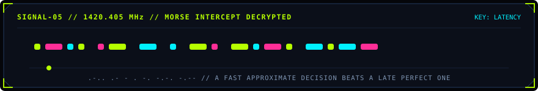
</picture>

</div>

```text
MORSE   : .-.. .- - . -. -.-. -.--
DECODED : LATENCY
AXIOM   : "A fast approximate decision beats a perfect one that arrives after the state has moved."
```

</details>

</details>

---

## 05 // OPEN CHANNELS

<div align="center">

<picture>
  <source media="(prefers-color-scheme: dark)" srcset="./assets/footer-dark.svg" />
  <source media="(prefers-color-scheme: light)" srcset="./assets/footer-light.svg" />
  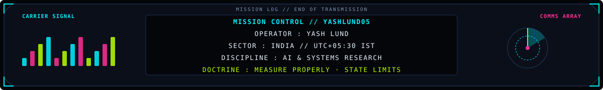
</picture>

<br/>

**OPEN CHANNELS:** &nbsp;
[GITHUB // `yashlund05`](https://github.com/yashlund05) &nbsp;·&nbsp;
[EMAIL // `yashlund05@gmail.com`](mailto:yashlund05@gmail.com) &nbsp;·&nbsp;
[LINKEDIN // `yash-lund`](https://www.linkedin.com/in/yash-lund-566835338/) &nbsp;·&nbsp;
[KAGGLE // `yashlund`](https://www.kaggle.com/yashlund) &nbsp;·&nbsp;
[ORCID // `0009-0004-8796-4271`](https://orcid.org/0009-0004-8796-4271)

</div>
